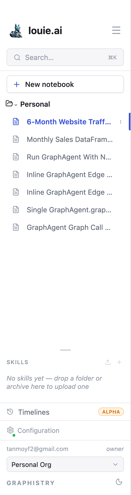

# Interface Navigation

## Organization context

You work inside one organization at a time, shown at the bottom of the sidebar
with your account. You may belong to several:

- Your personal space
- Your team
- Teams you collaborate with

Use the organization switcher to move between them. What you can see — notebooks,
connectors, skills — follows the organization you are currently in.

## Folders and notebooks

Notebooks live in folders. **Personal** is yours alone; an organization's folders
are shared with its members.

- **New notebook** creates one in the current folder
- **New subfolder** (Shift+N) adds a folder
- **Search** (⌘K) jumps straight to a notebook by name

Each notebook has a **⋯ Actions** menu for Rename, Duplicate, Copy to org… and
Delete. See [Notebook Management](011_Notebook_Management.md).

## Skills and timelines

**SKILLS** lists the skills available to the current notebook; a folder or
archive can be dropped onto it to upload one. **Timelines** opens the timeline
workspace.

## Data connectors

Connectors are configured under **Configuration**, which also shows each one's
health. A connector must be healthy before an agent can query it.
