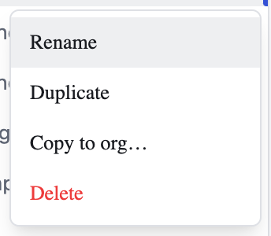

# Notebook Management

A **notebook** holds your analysis: the cells you run, their outputs, and the
conversation that produced them. Notebooks live in folders — your **Personal**
space, plus a folder for each organisation you belong to.

## Renaming a notebook

Select the **⋯** button beside a notebook in the sidebar and choose **Rename**.
The same menu offers **Duplicate**, **Copy to org…** and **Delete**.

## Finding a notebook again

The folder view lists every notebook with the time it was **Last modified**,
so the work you were most recently in stays at hand. Use **Search** (⌘K) to
jump straight to a notebook by name.
