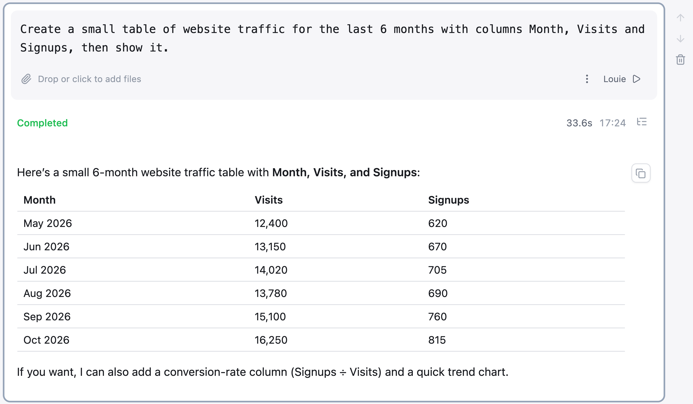

# Running Cells

## Running a cell

1. Write your request in the cell's prompt box
2. Choose an agent with **Select agent** — see [The Cell Toolbar](014_Cell_Toolbar.md)
3. Run it with **Run cell** (⌘+Enter)

## While it runs

The cell header shows live status — **Running** while work is in progress, then
**Completed** with the elapsed time. Alongside it you get the number of tool
calls made and the tokens consumed, broken into input, reasoning and output.

Expanding the tool-call summary shows each call the agent made and what it
returned, so a surprising answer can be traced back to the step that produced it.

## After it finishes

Outputs are live, not static: tables can be sorted and charts reconfigured in
place. Anything a cell names is available to later cells in the same notebook.
