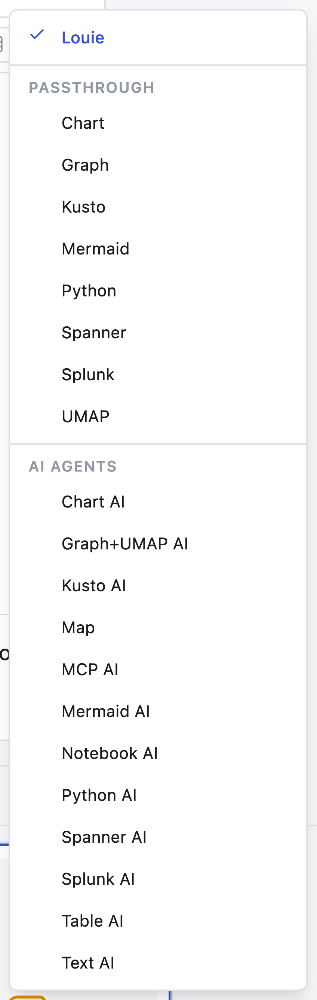

# Running AI Cells

An **AI agent** takes a request in plain language, works out the query or code
to satisfy it, runs that, and returns the result.

## How to run one

1. Choose an AI agent with **Select agent** — they are grouped under **AI AGENTS**
2. Describe what you want in plain language
3. Run the cell

The agent decides which tools to call and in what order. The cell header reports
how many tool calls it made, and expanding it shows each one.

## The AI agents

Chart AI · Graph+UMAP AI · Kusto AI · Map · MCP AI · Mermaid AI ·
Notebook AI · Python AI · Spanner AI · Splunk AI · Table AI · Text AI

Reach for one of these when you want the query written for you. When you already
know the query, use the matching passthrough agent instead — see
[Running Non-AI Cells](018_Running_Non_AI_Cells.md).
