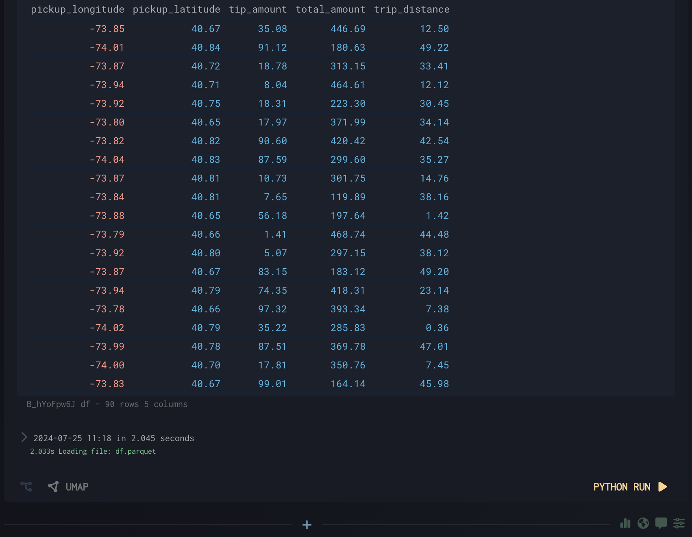
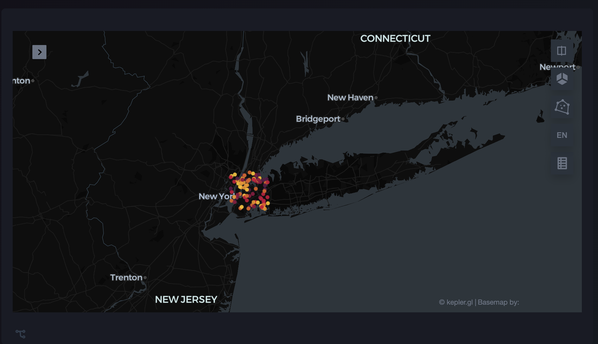
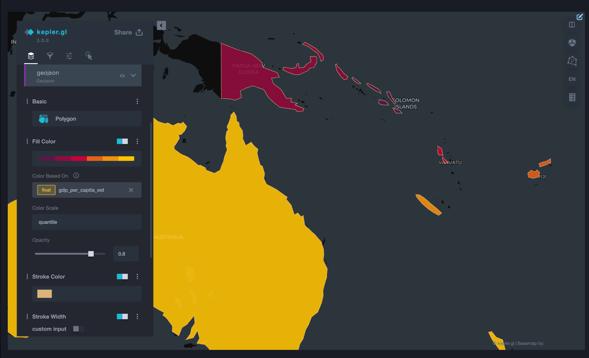
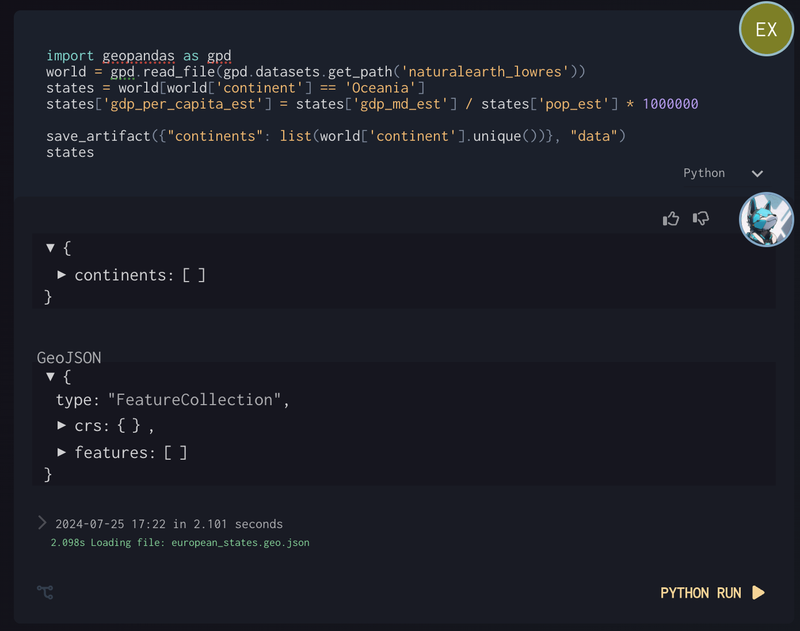

# Python Maps

A dataframe with geographic columns, or a GeoJSON value, can be rendered on a map. Maps are drawn by kepler.gl, not by Perspective, so they do not appear in the chart type picker.

## Features

- Click to add Geo Visualization when GeoJSON or dataframe with geo columns is displayed
- Support for dataframes with Latitude & Longitude columns
- GeoPandas integration for advanced geographic data handling
- Polygon color customization
- Appearance editing through Kepler interface

## Examples

### GeoPandas Example
(continents json output for debug inspection)

### Setting polygon color
Edit appearance in Kepler

### Example with two outputs

