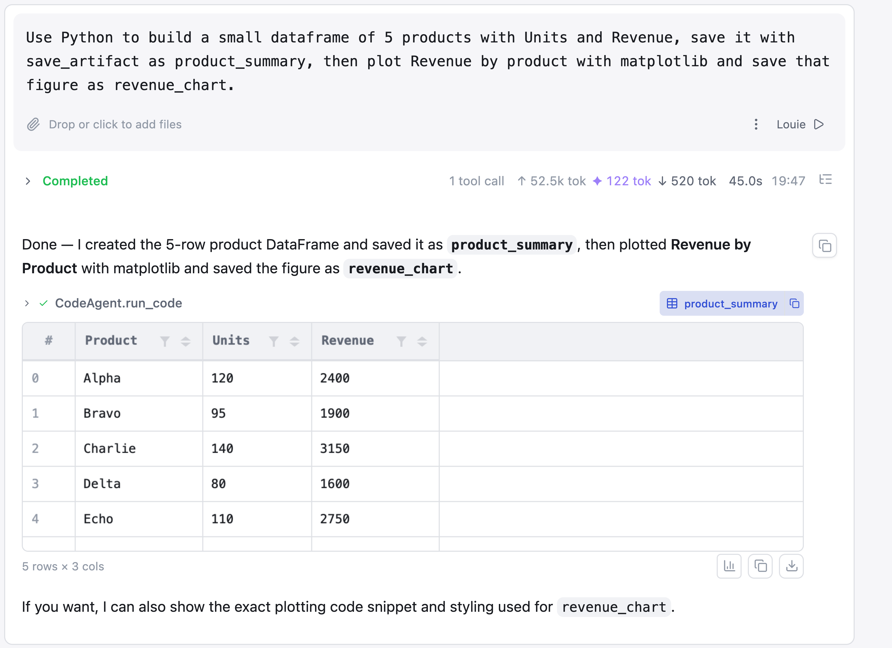

# Python Outputs

Outputs are saved with `save_artifact(value, "name")`. Each saved value becomes
a named value in the notebook, usable by later cells and listed in the
**Variables** panel.

## Supported Outputs
Use `save_artifact(x, "name")` with the following data types:

- Pandas DataFrame
- Pandas Series
- Dict (as Json)
- String (as Markdown)
- Matplotlib Figure (as png)
- PIL Image (as png)
- Plotly Figure Plotly (Plotly Json)
- GeoDataFrame (as GeoJson)
- GeoJSON FeatureCollection (as GeoJson)

## Visualization Types
- Matplotlib (seaborn)
- Plotly w/ Interactivity (Our default charts use Plotly also)

## Examples

