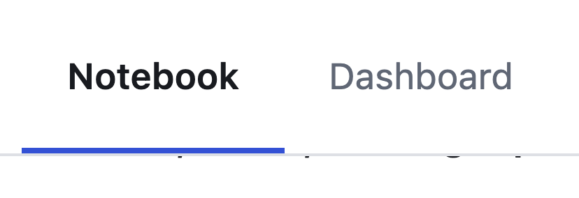

# Notebook and Dashboard Tabs

Every notebook has two views, switched from the tabs at the top.

**Notebook** is where you work: cells, their prompts and their outputs in order.

**Dashboard** presents chosen outputs as panels, without the prompts that
produced them. Panels read from the same cells, so refreshing the dashboard
re-runs the notebook behind it.

The **View / Edit** toggle applies to whichever tab you are on. In View mode the
prompts and editing controls are hidden, which is what you want when sharing a
notebook with someone who only needs the result.

See [Add and Edit Panels](028_Add___Edit_Panels.md) and
[Responsive Panel Layouts](029_Responsive_Panel_Layouts.md).
