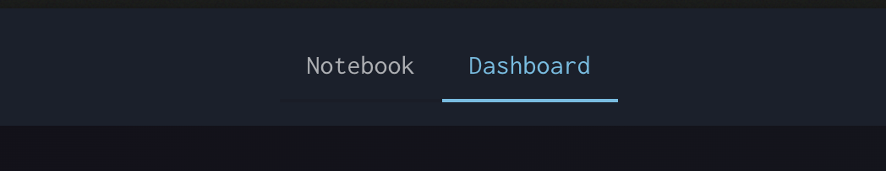
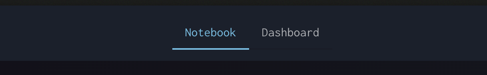

# Notebook vs Dashboard Tabs

At the top of each Notebook you'll find a set of tabs that allow you to switch between "Notebook" and "Dashboard".

## Dashboard Tab

"Dashboard" will open the respective Dashboard view of that notebook and allow you to create panels with dependencies from the notebook.

## Interface Views

