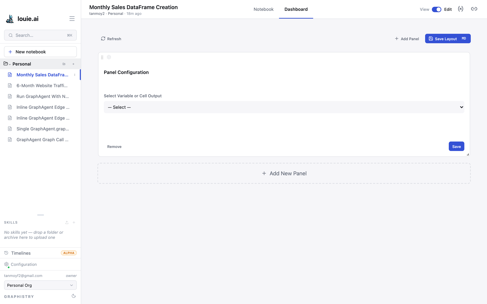

# Add and Edit Panels

A **dashboard** presents selected outputs from a notebook as panels. Switch to
it with the **Dashboard** tab at the top of a notebook.

## Adding a panel

**Add New Panel**, at the bottom of the dashboard, asks which cell element you
want to show. Choose one and select **Save**.

Any output a cell produced can become a panel — a table, a chart, a graph, a
map, or an input group.

## Editing a panel

**Panel settings** on a panel opens its configuration. **Remove** takes it off
the dashboard; the cell that produced it is untouched, so removing a panel never
destroys any work.

## Keeping it current

**Refresh** re-runs the notebook behind the dashboard, so panels pick up new
data. See [Refresh Data](032_Refresh_Data.md).
