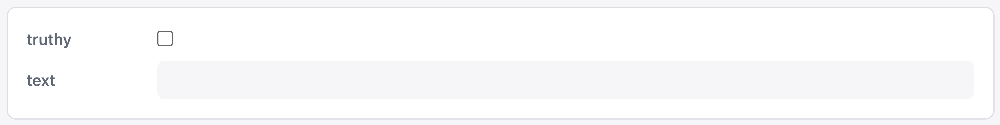

# Input Groups

Create one with **Add input group cell** on the cell toolbar. Two example inputs are added by default: a toggle and a text field.

Configure the input group by modifying the JSON, and then use the parameters within your queries by prefacing the name with a colon (i.e. :country, :date, :count, etc).

Add the input group to a panel like you would any other output element.

When in the Dashboard view, interacting with the inputs will automatically update the queries and their respective panels.

