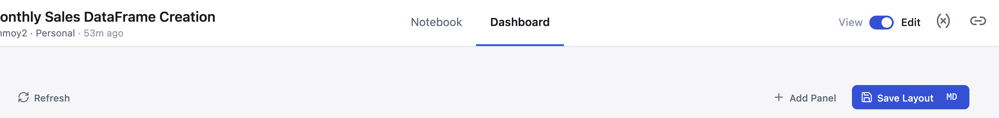

# Refreshing Data

**Refresh**, at the top of a dashboard, re-runs the notebook behind it so every
panel picks up current data.

Refreshing re-runs **all** cells in the notebook, in order. It therefore:

- Re-queries every connector the notebook touches
- Re-applies any changes made to cells since the last run
- Costs whatever the full notebook costs to run

On a notebook with slow queries this is not instant, and it is not a cheap
operation to leave on a timer.

Input group parameters are read at refresh time, so changing a parameter and
refreshing is how a dashboard is re-pointed at different data — see
[Input Groups](031_Input_Groups.md).
