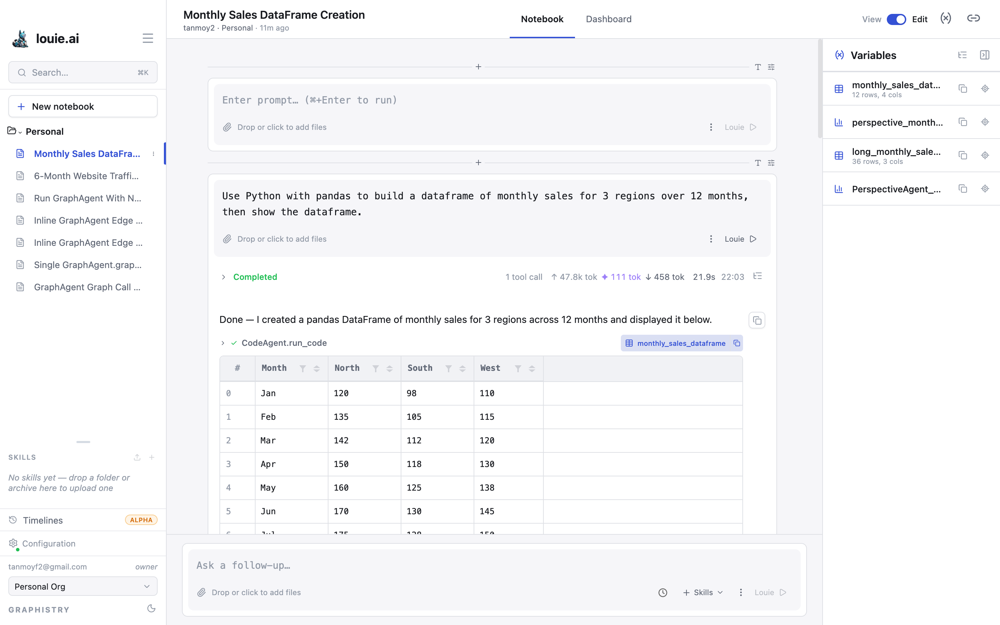

# Chart Authoring

Charts are made by running a cell with a charting agent. There are two routes,
and they produce the same kind of chart:

- **Chart AI** — describe the chart you want in plain language
- **Chart** (passthrough) — give the chart specification directly

Either way the result is a live Perspective chart that can be reconfigured in
place afterwards. See [Perspective Charts](037_Perspective_charts.md).

Python is a third route: a cell running the **Python** or **Python AI** agent
can build a figure with the usual libraries.

## What a chart is attached to

Charts act on a **named value** — usually a dataframe produced by an earlier
cell. Named values in a notebook are listed in the **Variables** panel, with
their shapes.

Name the dataframe you mean in your request. If you do not, the agent will pick
one, and with several in a notebook it may not pick the one you intended.
