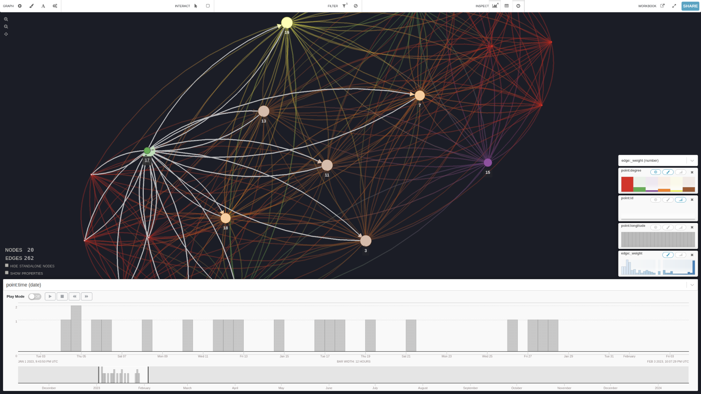
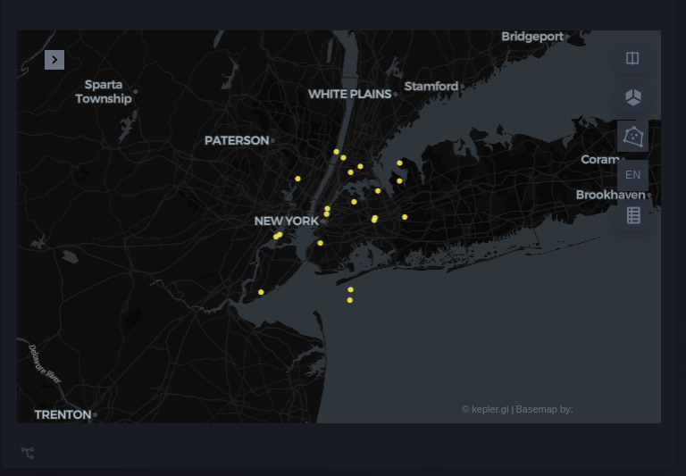
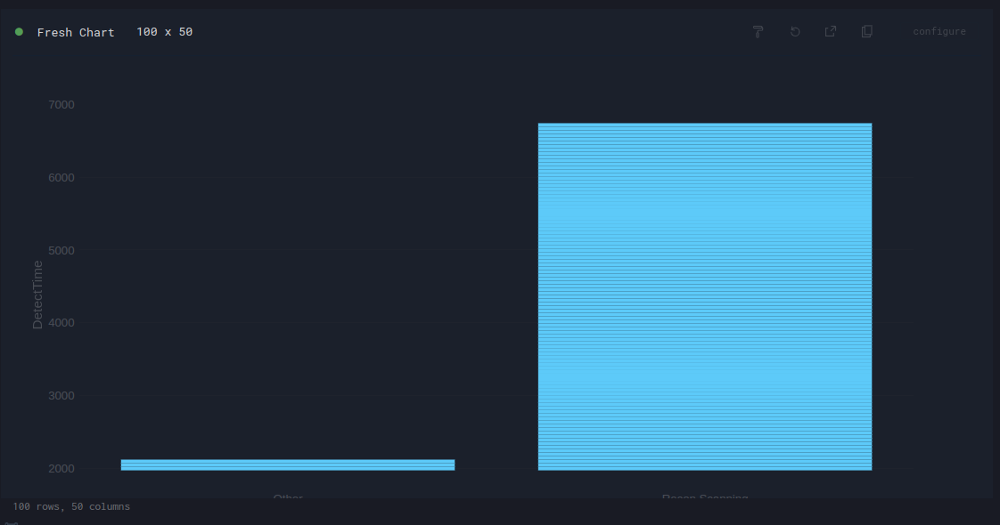
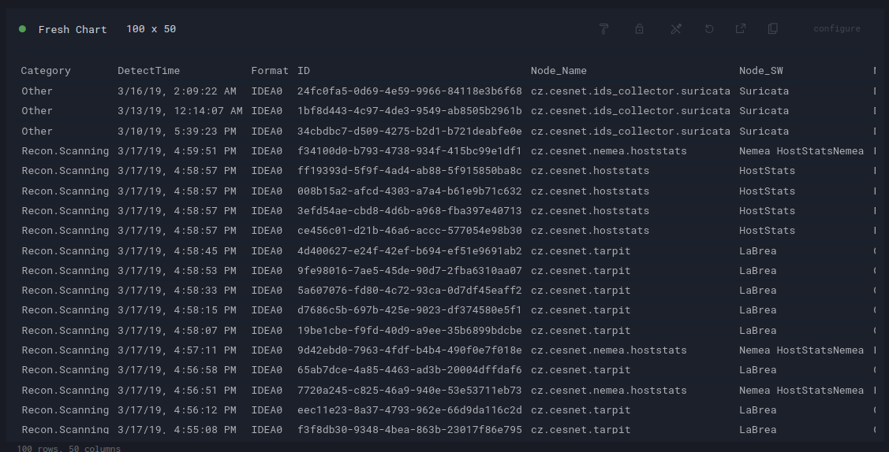
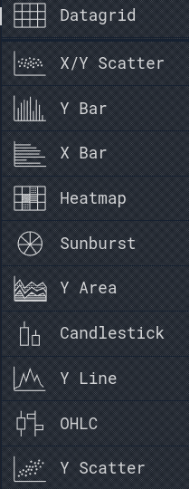

# Many Visualization Types Natively Supported

Louie renders several kinds of visualization natively. Which renderer is used determines what you can do with the result afterwards.

## Supported Types

**Graphs**
- Graphistry

**Maps**
- kepler.gl

**Charts**
- Perspective
- w/ Plotly

Anything else can be produced in Python and saved as an output — see [Python Outputs](024_Python_Outputs.md).

## Examples

