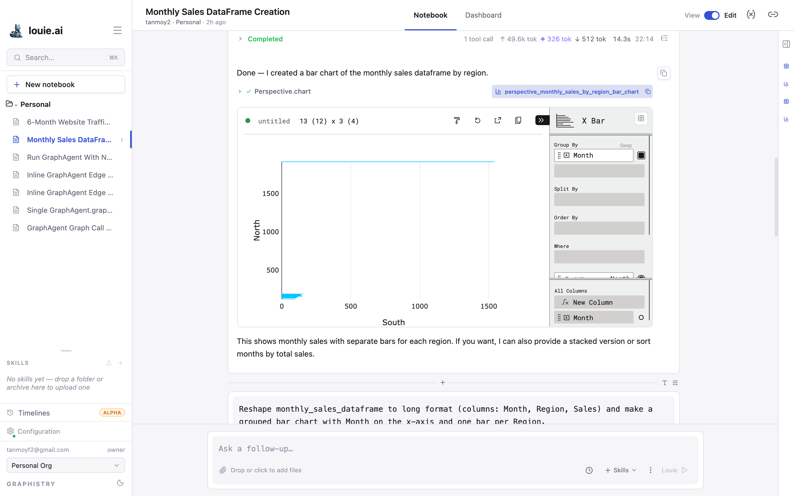

# Perspective Charts

Charts in Louie are rendered by **Perspective**. A chart is live: it can be
reconfigured in place without re-running the cell that made it, and the
configuration is saved with the notebook.

## The configuration panel

Open a chart's configuration with the **»** control in its top-right corner.

| Field | What it does |
|---|---|
| **Chart type** | Named at the top of the panel — select it to switch |
| **Group By** | The category axis. Rows are grouped by these columns |
| **Split By** | Splits each group into a series per distinct value |
| **Order By** | Sorts the result |
| **Where** | Filters rows before plotting |
| **All Columns** | The columns available, and **New Column** for a computed one |

The header shows the chart's name and its shape — rows and columns, with the
visible counts in parentheses.

## Toolbar

Beside the configuration control are **reset**, **export**, **copy** and a theme
control. The notebook's own **Download table** button beside the chart exports
the underlying data.
