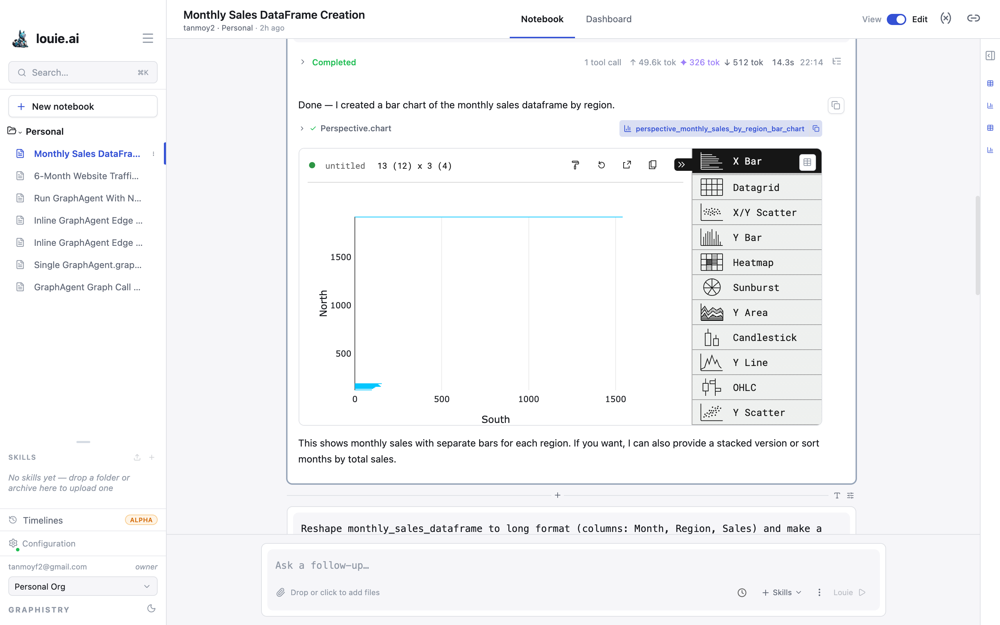

# Switching Chart Type

A chart's type can be changed at any time without re-running the cell. Open the
configuration panel and select the chart type named at the top.

## Available types

| Type | Shape |
|---|---|
| **Datagrid** | The data as a table |
| **X Bar** | Horizontal bars |
| **Y Bar** | Vertical bars |
| **Y Line** | Line |
| **Y Area** | Filled area |
| **Y Scatter** | Points against the category axis |
| **X/Y Scatter** | Points against two value axes |
| **Heatmap** | Grid shaded by value |
| **Sunburst** | Nested proportions |
| **Candlestick** | Open/high/low/close |
| **OHLC** | Open/high/low/close, bar form |

Datagrid is a chart type like any other, so a chart can be turned back into a
table and then into a different chart without losing its grouping or filters.

Switching type keeps **Group By**, **Split By**, **Order By** and **Where**.
Types that need more columns than you have configured will render empty until
you supply them.

Maps and graphs are not Perspective charts and are not in this list.
