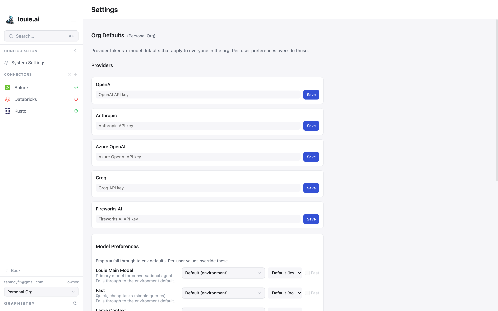

# Providers and Models

Louie ships with models already configured, so you can start work without
setting anything up. Configuring your own provider is **optional**. Do it when
you want Louie to bill against your own account, use a provider your
organization has standardised on, or pin particular models.

## Where the settings live

**Configuration → System Settings**, from the bottom of the sidebar.

Settings here are **org defaults** — they apply to everyone in the organization,
and each user's own preferences override them.

## Provider tokens

Five providers can hold a token:

- OpenAI
- Anthropic
- Azure OpenAI
- Groq
- Fireworks AI

Paste the token and select **Save** for that provider.

Tokens are stored per organization. In your Personal org they are yours alone;
in a shared org they apply to every member, so only an org admin should set them.

## Model preferences

Four slots decide which model does which kind of work:

| Slot | Used for |
|---|---|
| **Louie Main Model** | the conversational agent |
| **Fast** | quick, cheap tasks such as simple queries |
| **Large Context** | tasks needing large context windows |
| **Reasoning** | deep reasoning and multi-step problems |

Leaving a slot empty falls through to the environment default, which is what a
fresh install uses. As with tokens, a user's own preference overrides the org
default.

## Starting over

**Reset to environment defaults** removes every org provider token and every org
model default, returning the organization to whatever the environment supplies.

## Getting a token

If you do want your own provider, create a key in that provider's console — for
OpenAI, **API Keys → Create new secret key** at
[platform.openai.com](https://platform.openai.com). Copy it immediately, as most
providers show a key only once, and keep it secret.

Billing is then between you and the provider; usage appears on their dashboard,
not in Louie.
