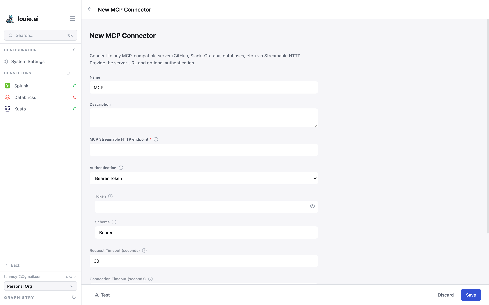

# Adding Data Connectors

## 1. Open the connector list

In the sidebar, select **Configuration**. The **CONNECTORS** section lists the
connectors your organization already has.

## 2. Start a new connector

Select the **+** beside the CONNECTORS heading. The **Select a connector type**
screen lists all twelve types.

## 3. Fill in the configuration

Each type asks for what it needs. Fields marked with an asterisk are required.
Every type takes a **Name** and an optional **Description**; the rest differ.

### Example: MCP

An MCP connector reaches any MCP-compatible server over Streamable HTTP:

| Field | Purpose |
|---|---|
| **MCP Streamable HTTP endpoint** | Full URL of the endpoint. Required |
| **Authentication** | Bearer Token, Basic Auth, or Graphistry Viewer |
| **Token** | The credential — for example a GitHub PAT |
| **Scheme** | Word placed before the token. Leave as `Bearer` unless the server expects something else |
| **Request Timeout** | For `session.initialize()` and tool calls |
| **Connection Timeout** | For establishing the TCP connection. Keep it short so a dead URL fails fast |

### Custom and secret headers

Some servers key off a header other than `Authorization` — `X-Scope-OrgID`,
`anthropic-version`, a gateway's own key. MCP connectors take up to 20 headers,
split by sensitivity:

- **Custom Headers** — ordinary configuration. Values stay readable and are
  stored in clear.
- **Secret Headers** — credentials such as `X-API-Key`. Values are stored as
  secrets and shown masked once saved.

Put anything secret in Secret Headers. `Authorization` itself is set by the
**Authentication** option, not here.

### Example: Spanner

Spanner asks for an **Instance ID**, a **Database ID** and a
**Service-Account JSON**.

## 4. Test, then save

Three buttons sit at the bottom of the form:

- **Test** — tries the connection without saving
- **Discard** — abandons the form
- **Save** — creates the connector

Test before saving. A connector that saves cleanly can still fail to connect.

## 5. Check it came up

The new connector appears under CONNECTORS. Open it and confirm it reports
**Connected** and has listed its **Assets**. If it has not, the activity log
below the assets gives the reason.

## Editing and removing

Open a connector to edit its configuration. If **Restart**, **Re-index** and
**Test Connection** are greyed out, its **Source** is **Environment** — it is
configured by whoever runs the server and is read-only here. See
[Data Connectors](connectors_overview.md).

## When something goes wrong

- Read the connector's activity log first; it usually names the failure
- Check that the host is reachable from the Louie server, not just from your machine
- Confirm the credentials have permission to read what you are asking for
- For an environment connector, the fix is on the server, not in the UI
