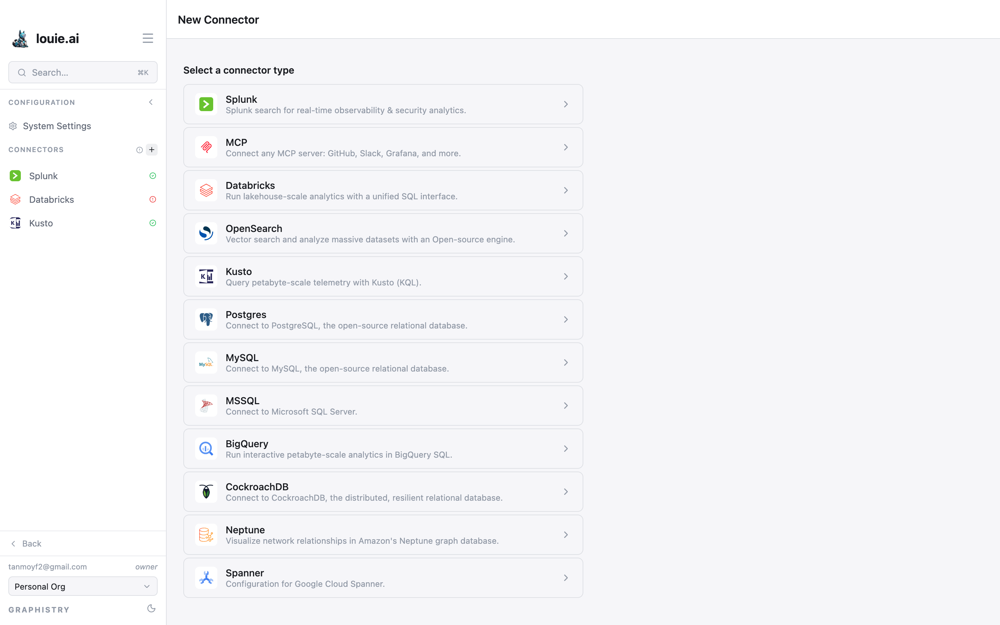
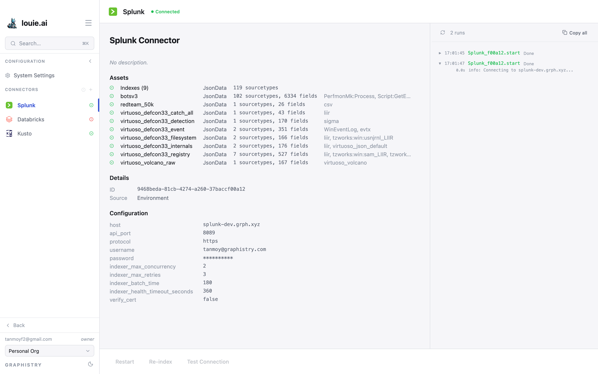

# Data Connectors

A **connector** gives Louie access to one of your data sources. Once a connector
is healthy, agents can query it — in natural language through an AI agent, or in
the source's own query language through a passthrough agent.

Connectors live under **Configuration → CONNECTORS** in the sidebar.

## Connector types

Twelve types are available:

| Type | What it connects to |
|---|---|
| **Splunk** | Splunk search for real-time observability & security analytics |
| **MCP** | Any MCP server — GitHub, Slack, Grafana, and more |
| **Databricks** | Lakehouse-scale analytics with a unified SQL interface |
| **OpenSearch** | Vector search over massive datasets |
| **Kusto** | Petabyte-scale telemetry with Kusto (KQL) |
| **Postgres** | PostgreSQL |
| **MySQL** | MySQL |
| **MSSQL** | Microsoft SQL Server |
| **BigQuery** | Interactive petabyte-scale analytics in BigQuery SQL |
| **CockroachDB** | Distributed, resilient relational database |
| **Neptune** | Amazon's Neptune graph database |
| **Spanner** | Google Cloud Spanner |

## Where a connector comes from

A connector's **Details** panel shows its **Source**:

- **Environment** — configured by whoever runs the server. These are
  **read-only** in the UI: Restart, Re-index and Test Connection are disabled,
  and the configuration cannot be edited from Louie.
- Added through the UI — editable by anyone with access to the organization.

This is the first thing to check when a connector's buttons are greyed out: it
is not a permission problem with your account, it is an environment connector.

## Status and assets

Open a connector to see its state. A healthy one reports **Connected**, and
lists the **Assets** it has indexed — for Splunk, each index with its sourcetype
and field counts.

Below that is a live log of the connector's own activity, with **Refresh** and
**Copy all** — the place to look when a connector is unhealthy.

## Keeping a connector current

**Re-index** refreshes what Louie knows about the source's structure. Run it
after schema changes, or when an agent cannot find a table or field you know
exists. **Restart** re-establishes the connection, and **Test Connection**
checks it without changing anything.

To add one, see [Adding Data Connectors](adding_connectors.md).
